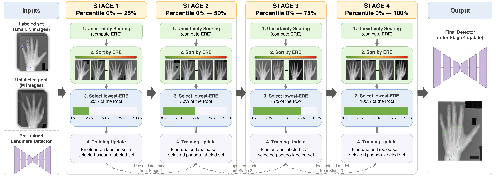

# PACER: Curriculum Self-Training with Spatial Uncertainty for Pseudo-Label Selection in Few-Shot Anatomical Landmark Detection

[](https://malga-vision.github.io/PACER-wacv27-AcademicPage/)
[](#citation)
[](#citation)
[](https://github.com/Malga-Vision/PACER-wacv27)
[](LICENSE)

**Roberto Di Via, Francesca Odone, Vito Paolo Pastore**
MaLGa, DIBRIS, University of Genoa, Italy

**WACV 2027** (IEEE/CVF Winter Conference on Applications of Computer Vision), Applications track

[Project page](https://malga-vision.github.io/PACER-wacv27-AcademicPage/) ·
Paper (coming soon) · arXiv (coming soon) ·
[Code](https://github.com/Malga-Vision/PACER-wacv27)

Official implementation of **PACER** (**P**ercentile-**A**daptive **C**urriculum on
**E**xpected **R**adial error), together with every baseline, ablation and analysis
reported in the paper and its supplementary material.

PACER is a lightweight self-training stage that improves a trained heatmap-based landmark
detector by mining an unlabeled pool: it ranks unlabeled images by the **Expected Radial
Error (ERE)**, a label-free, millimeter-scaled spatial uncertainty read from the predicted
heatmap, and admits them through a **percentile-adaptive curriculum gate** that grows from
easy to hard while tightening in absolute terms as the model improves.



---

## Repository layout

| Path | Description |
|------|-------------|
| `main.py` | Unified CLI entrypoint dispatching to every method |
| `shared/` | Shared code: `config`, `data`, `model`, `metrics`, `train_utils`, `selection`, `visualization` |
| `baseline/` | Base detector: `train-base` (oracle-only training) and `evaluate` |
| `pacer/` | **PACER**: curriculum `finetune`, ERE `selection`, `schedules` |
| `pacer/configs/` | `base.json` (base detector) and `finetune.json` (canonical PACER) |
| `pacer/ablation/` | `cap60.json`, `oracle_ft.json`, `random.json`, `per_landmark.json`, `ramp_concave.json`, `ramp_convex.json` |
| `ssl_methods/` | SSL pool baselines: Mean Teacher, FixMatch-pose, FlexMatch, FreeMatch |
| `sota/stld/` | STLD-HRNet: HRNet self-training baseline (the paper's STLD) |
| `hrnet/` | HRNetV2-W18 backbone (`vendor/`) and PACER-HRNet |
| `sota/diffusion/` | Pointer to the external diffusion priors ([CDPM-Align](https://github.com/Malga-Vision/CDPM-Align)) |
| `analysis/` | Scripts that turn the run tree into the paper's tables and figures |

All U-Net methods share one detector (SMP U-Net, ImageNet ResNet-101 encoder, grayscale,
256×256, spatial-softmax NLL on one-hot targets) and finetune from the **same**
per-(dataset, seed, budget) base checkpoint, so any difference between them is attributable
to the selection mechanism, not the initialization.

---

## Installation

```bash
conda create -n pacer python=3.10 -y && conda activate pacer
pip install -r requirements.txt
```

`requirements.txt` pins the versions used for the paper (PyTorch 2.4.1, CUDA 11.8). A CUDA
GPU is required for training; runs were produced on a single NVIDIA A30.

---

## Datasets

Point the `dataset_root` field of `pacer/configs/base.json` and `pacer/configs/finetune.json`
(and of the ablation configs) at your local datasets directory, and `output_dir` at where the
run tree should be written. The SSL and HRNet entrypoints inherit `dataset_root` from
`pacer/configs/finetune.json`. Both can be overridden per run with
`--override dataset_root=/abs/path --override output_dir=/abs/path`.

| `dataset` | Benchmark | Landmarks | Train/Val/Test | Errors in |
|-----------|-----------|-----------|----------------|-----------|
| `chest` | Shenzhen (lung-boundary annotation) | 6 | 195 / 34 / 50 | pixels (no calibration) |
| `cephalo` | ISBI2015 cephalometric | 19 | 130 / 20 / 250 | mm (0.1 mm/pixel) |
| `hand` | DHA (Digital Hand Atlas) | 37 | 550 / 59 / 301 | mm (wrist width = 50 mm) |

The oracle set of `N` images is drawn from the training split, seeded per run; the remaining
training images form the unlabeled pool. Pool labels are never used, only pool images. See
`shared/data.py` for the expected on-disk format of each benchmark.

---

## Quick start

```bash
# 1. Train the base detector on the oracle set only (writes base_checkpoint.pt,
#    base_metrics.json = the "ResNet-101 (ImageNet)" table row, and the oracle/pool id split).
python main.py train-base --config pacer/configs/base.json \
    --override dataset=cephalo --override initial_labeled=5 --override seed=42 --override gpu=0

# 2. PACER curriculum finetuning (canonical: 4-stage, cap 100, linear ramp, 120 epochs).
python main.py finetune --config pacer/configs/finetune.json \
    --override dataset=cephalo --override initial_labeled=5 --override seed=42 --override gpu=0

# 3. Evaluate any checkpoint (MRE, P95, SDR@2mm, ERE) on a split.
python main.py evaluate --config pacer/configs/finetune.json \
    --checkpoint <output_dir>/cephalo/seed_42/active_5/step-4_cap100/percentile/final_checkpoint.pt \
    --split test --save-dir eval_out
```

Every method writes under `<output_dir>/<dataset>/seed_<seed>/active_<N>/`:

| Run | Directory |
|-----|-----------|
| base detector | `base/` |
| PACER / its ablations | `<schedule_tag>/<variant>/`, e.g. `step-4_cap100/percentile`, `step-8_cap60/percentile`, `step-4_cap100_gamma2/percentile`, `step-4_cap100/random`, `step-4_cap100/per_landmark`, `flat_cap0/percentile` (oracle-ft) |
| SSL baselines, STLD-HRNet | `ssl/<method>/` (`mean_teacher`, `fixmatch_pose`, `flexmatch`, `freematch`, `stld_hrnet`) |
| PACER-HRNet | `step-4/pacer_hrnet/` |

`metrics_final.json` (`base_metrics.json` for the base) holds the val/test metrics.

---

## Reproducing the paper

The few-shot budget is `initial_labeled ∈ {5, 10}` (5-shot in the main paper, 10-shot in the
supplement); repeat each configuration over the seeds (see [Reproducibility](#reproducibility)).
Table and figure numbers refer to the final WACV 2027 paper ("Suppl." = supplementary
material). Training commands produce the runs; the `analysis/` scripts aggregate them.

| Paper artifact | Runs | Aggregation |
|----------------|------|-------------|
| **Tab. 1** 5-shot main results / **Suppl. Tab. 3** 10-shot: ResNet-101 (ImageNet) row | `train-base` | `analysis/summarize.py --runs base` |
| Tab. 1 / Suppl. Tab. 3: Mean Teacher, FixMatch-pose, FlexMatch, FreeMatch | `main.py <method> ...` | `analysis/summarize.py --runs mean_teacher fixmatch_pose flexmatch freematch pacer4 --ref pacer4` (paired t-test) |
| Tab. 1 / Suppl. Tab. 3: **PACER (4-stage)** | `finetune` (default config) | `analysis/summarize.py --runs pacer4` |
| Tab. 1 / Suppl. Tab. 3: STLD-HRNet, PACER-HRNet (Sec. 4.5) | `main.py stld-hrnet ...`, `main.py pacer-hrnet ... --schedule_tag step-4` | `analysis/summarize.py --runs ssl/stld_hrnet step-4/pacer_hrnet` |
| Tab. 1 / Suppl. Tab. 3: CDPM-Align + PACER | `finetune --checkpoint <cdpm_align_detector.pt>` | `analysis/summarize.py` on that run |
| Tab. 1 / Suppl. Tab. 3: CDPM-Align | external, see [Diffusion priors](#diffusion-pretrained-priors-external) | — |
| **Suppl. Tab. 2** computational cost | wall-clock / peak memory of the runs above at matched budget (one A30) | — |
| **Suppl. Tabs. 4–5** curriculum staging, incl. oracle-ft | `finetune ... num_stages∈{1,2,4,8}`; `finetune --config pacer/ablation/oracle_ft.json` | `analysis/summarize.py --runs flat_cap0/percentile flat_cap100/percentile step-2_cap100/percentile step-4_cap100/percentile step-8_cap100/percentile` |
| **Suppl. Tabs. 6–7** admission cap Π = 60 vs 100 | `finetune --config pacer/ablation/cap60.json ... num_stages∈{1,2,4,8}` | `analysis/summarize.py --runs step-<T>_cap60/percentile step-<T>_cap100/percentile` |
| **Suppl. Tabs. 8–9, Suppl. Fig. 4** shape of the admission ramp (γ ∈ {½, 1, 2}) | `finetune --config pacer/ablation/ramp_concave.json` / default / `ramp_convex.json` | `analysis/ramp_shape.py` (writes `table_shape.tex`, `schedule_shape.pdf`) |
| **Suppl. Tabs. 10–11** selection signal: lowest-ERE vs random | `finetune --config pacer/ablation/random.json ... num_stages∈{1,2,4,8}` | `analysis/summarize.py --runs step-<T>_cap100/random step-<T>_cap100/percentile` |
| **Suppl. Figs. 5 / 3, Suppl. Tab. 12** ranking quality (ERE vs peak confidence, entropy, 11-view TTA, anisotropic-Gaussian read-out; Spearman / Pearson) | base checkpoints only | `analysis/ranking_quality.py` (writes `ranking_quality_{5,10}shot.pdf` + Tab. 12 rows) |
| **Suppl. Tabs. 13–14** image-level vs per-landmark gating | `finetune --config pacer/ablation/per_landmark.json ... num_stages∈{1,2,4,8}` | `analysis/summarize.py --runs step-<T>_cap100/per_landmark step-<T>_cap100/percentile` |
| **Suppl. Fig. 6 (self-tightening)** mean admitted ERE per stage, Π = 100 vs 60 | 4-stage runs at both caps | `analysis/self_tightening.py` (writes `self_tightening_caps.pdf`) |
| **Fig. 1** (5-shot) / **Suppl. Fig. 6 (per-image)** (10-shot) per-image self-tightening | 4-stage `finetune ... --override seed=14 --override dump_stage_artifacts=true` | `analysis/self_tightening_qual.py --budget {5,10}` |
| **Suppl. Tab. 15** per-landmark clinical gain | base + PACER 4-stage runs | `analysis/per_landmark_gain.py` |
| **Suppl. Tabs. 16–17** robust statistics (median, IQR) | base, SSL and PACER 4-stage runs | `analysis/dump_sample_errors.py` then `analysis/robust_stats.py` |

All `analysis/` scripts take `--results <output_dir>` (and `--dataset-root`, `--out` where
they run inference or write files) and never write into the run tree. Run them from the
repository root, e.g. `python analysis/ramp_shape.py --results /path/to/results --out figures`.

### SSL baselines

```bash
python main.py mean-teacher  --dataset cephalo --initial_labeled 5 --seed 42 --gpu 0
python main.py fixmatch-pose --dataset cephalo --initial_labeled 5 --seed 42 --gpu 0
python main.py flexmatch     --dataset cephalo --initial_labeled 5 --seed 42 --gpu 0
python main.py freematch     --dataset cephalo --initial_labeled 5 --seed 42 --gpu 0
```

SSL methods reuse the same base checkpoint and the matched 120-epoch budget; they read
`dataset_root` and the detector settings from `pacer/configs/finetune.json`. FixMatch-pose
and FlexMatch calibrate τ as the 0.8-quantile of the oracle peak confidences
(`--tau_quantile`), FreeMatch derives it on the fly. The paper runs of the SSL and HRNet
entrypoints used `--override num_workers=3` (augmentation streams are tied to the worker
count, so this matters only for per-seed bit-level comparisons).

### HRNet self-training

```bash
# STLD-HRNet (shrinking-sigma pseudo-label curriculum, 396 epochs)
python main.py stld-hrnet  --dataset hand --initial_labeled 5 --seed 42 --gpu 0 \
    --imagenet_weights hrnet/vendor/hrnetv2_w18_imagenet_pretrained.pth

# PACER-HRNet (60-epoch oracle warmup + 4-stage percentile-ERE curriculum, 180 epochs)
python main.py pacer-hrnet --dataset hand --initial_labeled 5 --seed 42 --gpu 0 \
    --schedule_tag step-4 \
    --imagenet_weights hrnet/vendor/hrnetv2_w18_imagenet_pretrained.pth
```

The HRNet family trains at **batch size 16** (enforced by the entrypoint). Download the
HRNetV2-W18 ImageNet-pretrained weights (`hrnetv2_w18_imagenet_pretrained.pth`) from the
official [HRNet-Image-Classification](https://github.com/HRNet/HRNet-Image-Classification)
repository and place them at `hrnet/vendor/`. Without `--imagenet_weights` the backbone is
normally-initialized (not the paper setting).

### Ablations (dedicated configs)

```bash
# Curriculum staging: flat (= vanilla self-training) / 2 / 4 / 8 stages at cap 100
for T in 1 2 4 8; do
  python main.py finetune --config pacer/configs/finetune.json \
      --override dataset=hand --override initial_labeled=5 --override seed=42 --override gpu=0 \
      --override num_stages=$T
done

# oracle-ft control (finetune on the oracle set alone: percentile_cap=0 admits no pool sample)
python main.py finetune --config pacer/ablation/oracle_ft.json \
    --override dataset=hand --override initial_labeled=5 --override seed=42

# Cap: withhold the noisiest 40% of the pool (cap 60) vs the full pool (cap 100), every T
python main.py finetune --config pacer/ablation/cap60.json \
    --override dataset=hand --override initial_labeled=5 --override seed=42 --override num_stages=4

# Shape of the admission ramp: pi_t = cap * (t/T)^gamma, T=4, cap=100, same 120 epochs
python main.py finetune --config pacer/ablation/ramp_concave.json \
    --override dataset=hand --override initial_labeled=5 --override seed=42   # gamma = 1/2
python main.py finetune --config pacer/ablation/ramp_convex.json \
    --override dataset=hand --override initial_labeled=5 --override seed=42   # gamma = 2

# Selection signal: random admission (same curriculum and per-stage budget, ERE ranking removed)
python main.py finetune --config pacer/ablation/random.json \
    --override dataset=hand --override initial_labeled=5 --override seed=42 --override num_stages=4

# Per-landmark gating (admit individual landmarks by their own ERE, same percentile curriculum)
python main.py finetune --config pacer/ablation/per_landmark.json \
    --override dataset=hand --override initial_labeled=5 --override seed=42 --override num_stages=4
```

### PACER finetuning options

`pacer/configs/finetune.json` is the **canonical PACER** of the paper: 4-stage curriculum,
`percentile_cap=100`, linear ramp, 120 epochs, 5-shot, batch size 8, AdamW lr 1e-5. Each knob
below maps to one paper experiment and can be set in the config or via `--override KEY=VALUE`.

| Option | Values | Meaning |
|--------|--------|---------|
| `num_stages` (T) | 1, 2, 4, 8 | Curriculum length. `1` = *flat* = vanilla self-training. Default **4**. |
| `percentile_cap` (Π) | [0, 100] | Final gate level. `100` = whole pool by the last stage; `60` = withhold the noisiest 40%; **`0` = oracle-ft** (admit no pool sample). |
| `schedule_gamma` (γ) | > 0, default **1** | Ramp shape, π_t = Π·(t/T)^γ with the same endpoints and epoch boundaries. `1` = linear (the paper's PACER, Eq. 4), `0.5` = concave / front-loaded, `2` = convex / keeps the gate tight for longer. Non-default values append `_gamma<γ>` to the run directory. |
| `total_epochs` (E) | int | Matched compute budget, split into T equal stages. Default **120**. |
| `gating` | `image` (default), `landmark` | Admit whole images by mean ERE (PACER) or individual landmarks by their own ERE under the same percentile gate. |
| `admission_random` | `false` (default), `true` | Replace lowest-ERE ranking with a uniformly random subset of the same per-stage size (selection-signal control; image-level only). |
| `dump_stage_artifacts` | `false` (default), `true` | Save each stage's scoring model and pool ERE (`stage_artifacts/`), used by the qualitative self-tightening figures. |

### Diffusion-pretrained priors (external)

DDPM and CDPM-Align are diffusion-pretrained few-shot landmark detectors that learn an
anatomy prior through generative pretraining. They are **not** part of this release:
CDPM-Align (MICCAI 2026) is related work from our lab, with official code at
[Malga-Vision/CDPM-Align](https://github.com/Malga-Vision/CDPM-Align). The **CDPM-Align + PACER**
row runs PACER from a CDPM-Align detector checkpoint (same SMP U-Net / ResNet-101, saved as a
full state dict) in place of the ImageNet base:

```bash
python main.py finetune --config pacer/configs/finetune.json \
    --checkpoint /path/to/cdpm_align_detector_checkpoint.pt \
    --override dataset=hand --override initial_labeled=5 --override seed=42
```

---

## Reproducibility

The oracle/pool split, ERE scoring, and pseudo-label selection (including the random-admission
draw) are **deterministic**. GPU **training**, however, is not bit-reproducible: the U-Net uses
CUDA ops with no deterministic kernel, and `set_seed` calls
`torch.use_deterministic_algorithms(True, warn_only=True)`, so those ops fall back to
non-deterministic implementations. Single-seed metrics therefore vary run-to-run (and across
hardware/library versions) within the method's seed variance.

**Reproduce at the multi-seed level**, not the single seed. Tables report **mean ± std over
three to five seeds**: every PACER cell (and its ablations) averages seeds **14, 42, 90**; the
base detector and the SSL references average up to five seeds (7, 14, 42, 90, 123). The exact
seed set of every main-table cell is listed in `analysis/seed_basis.json` (used by
`analysis/robust_stats.py`); pass the same seeds to `analysis/summarize.py --seeds ...`.
Do not expect a single seed to match a specific cell.

---

## Method overview

1. Train a base detector on a small oracle-labeled subset.
2. At the start of each stage, score the unlabeled pool by **ERE**, a heatmap-derived
   uncertainty in physical mm.
3. Admit the lowest-ERE π_t % of the pool as pseudo-labels (easiest first), freezing their
   decoded one-hot targets for the stage.
4. Train on oracle + admitted pseudo-labels for the stage's epoch budget.
5. Re-score the pool and repeat with a wider gate, π_t = (t/T)·Π.

The gate is **self-tightening**: as the model sharpens, the pool ERE distribution shifts
toward zero, so a constant percentile maps to a progressively smaller absolute threshold:
the gate grows stricter in millimeters even as it widens in percentile. The curriculum is
specified by two interpretable scalars, the stage count T and the cap Π (the ramp shape γ is
an optional, second-order knob studied in the supplement).

---

## Related work from our lab

- **CDPM-Align** (MICCAI 2026): conditional-diffusion pretraining for few-shot landmark
  detection, the diffusion prior PACER is applied on top of in the paper.
  Code: [Malga-Vision/CDPM-Align](https://github.com/Malga-Vision/CDPM-Align).

## Acknowledgements

`hrnet/vendor/` vendors the HRNetV2 backbone from the official HRNet implementation; its
original license and author attribution are retained in those files.

## Citation

If you find this work useful, please cite:

```bibtex
@inproceedings{divia2027pacer,
  title     = {{PACER}: Curriculum Self-Training with Spatial Uncertainty for Pseudo-Label Selection in Few-Shot Anatomical Landmark Detection},
  author    = {Di Via, Roberto and Odone, Francesca and Pastore, Vito Paolo},
  booktitle = {Proceedings of the IEEE/CVF Winter Conference on Applications of Computer Vision (WACV)},
  year      = {2027}
}
```

## License

Released under the [MIT License](LICENSE).
